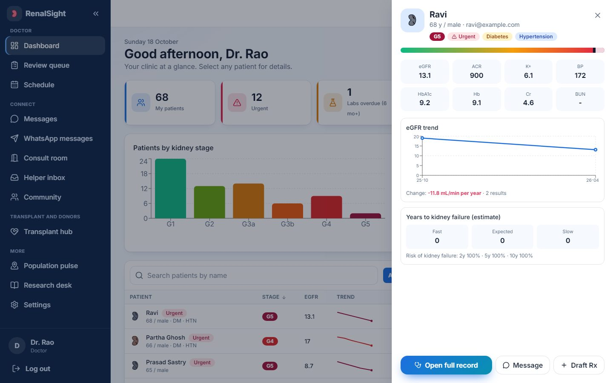

<div align="center">

# RenalSight

### Detect · Stage · Forecast · Treat · Connect

**An AI platform for chronic kidney disease (CKD), built for patients, doctors and families, in English, Tamil, Bengali and Telugu.**


</div>

> **Learning and demonstration project.** RenalSight gives decision-support estimates, not diagnoses, and is not a medical device. Read [Honest limits](#honest-limits) before relying on any number.

---

## Why RenalSight

Kidney disease is silent until it is advanced. Most people meet it as a creatinine number they cannot interpret, a doctor who sees too many patients, and a family that does not know how to help, or how to find a donor.

RenalSight turns a handful of lab values into something a person can *see and act on*:

- a **Living Kidney** that is visibly wounded in proportion to what the labs show, and heals when they improve
- a **forecast** of how fast kidney function may fall, as a range, never a date
- a **care plan and draft prescription** that a doctor reviews, overrides if needed, and signs
- a **doctor console** that ranks every patient by severity and opens any record in one click
- a **transplant and donor hub** that writes a polished appeal and shares it in one click
- **agentic helpers** that explain, draft and plan, but never act without human approval

---

## Screenshots

<table>
  <tr>
    <td width="50%"><br><sub><b>Patient home.</b> Kidney status, care plan, notifications and a question box.</sub></td>
    <td width="50%"><br><sub><b>Doctor dashboard.</b> KPIs, stage distribution, needs-attention list and a sortable patient table.</sub></td>
  </tr>
  <tr>
    <td><br><sub><b>Time machine.</b> Fast, expected and slow paths with what-if sliders.</sub></td>
    <td><br><sub><b>Touch a patient.</b> A quick view with labs, trend, forecast and one-click actions.</sub></td>
  </tr>
  <tr>
    <td><br><sub><b>Transplant and donor hub.</b> Appeals, registry, hospitals, journey, dialysis log.</sub></td>
    <td><br><sub><b>Donor appeal.</b> Hospital, patient and blood group in; a polished message out.</sub></td>
  </tr>
  <tr>
    <td><br><sub><b>Light and dark themes</b> that still shift teal, amber and rose with severity.</sub></td>
    <td><br><sub><b>Population Pulse.</b> CKD cases by region and year, with care needs and scenarios.</sub></td>
  </tr>
  <tr>
    <td><br><sub><b>Lab reports.</b> Type, paste, upload, or fill from a real dataset sample.</sub></td>
    <td><br><sub><b>Patient record.</b> Overview, labs, prescriptions and live messages in tabs.</sub></td>
  </tr>
</table>

---

## Features

| Area | What it does |
|---|---|
| **Living Kidney** | SVG kidney with five stages from healthy to destroyed. Wounds map to real labs: cracks for eGFR, leaking drops for urine protein, swollen veins for blood pressure, pallor for anaemia, flicker for potassium. Tap a mark to learn why it is there. The whole app shifts teal, amber or rose with severity. |
| **Clinical engine** | CKD-EPI 2021 eGFR, KDIGO G and A staging, a CKD detector (XGBoost with SHAP reasons), KFRE dialysis-risk, progression forecast with fast, expected and slow ranges, what-if sliders, group survival outlook from NHANES. |
| **Lab reports** | Manual entry, history chart, paste or upload TXT, CSV or text PDF (units converted, you confirm before saving), photo OCR when Tesseract is installed, and one-click **real sample records** for each kidney-function band. |
| **Rx Studio** | Care plan, draft medicines from KDIGO-style rules, a deterministic safety engine (renal doses, interactions, NSAIDs, potassium), doctor review, written override (audit-logged), e-signature and PDF. Patients never see unsigned doses. |
| **Doctor console** | Bright, clinical theme. Patient table with stage, eGFR, trend sparkline, change per year and severity. Click a patient for a quick-view drawer, then a full record with labs, prescriptions and live chat. Review queue and schedule. |
| **Connect** | Direct line (WebSocket chat with typing, read ticks, attachments), consult rooms with a six-digit code and shared checklist, community channels with reporting and auto-hide, care hub and appointments. |
| **Translate everything** | One toggle translates chat messages, previews, AI answers and posts into the chosen language, with the original one click away. Translations are cached. |
| **Transplant and donor hub** | Hospital directory with autocomplete, donor appeals with a public QR page, ABO compatibility and living-donor matching, a donor registry (kidney and liver while alive; heart, kidney, liver, lungs, eyes and tissue after death), coordinator verification, dialysis seat board, 10-step transplant journey, dialysis log, emergency ID with QR, FHIR export and referral-letter PDF. |
| **One-click sharing** | Type a hospital, patient, blood group and phone. RenalSight writes a message in four languages and three tones and opens WhatsApp, Telegram, SMS or e-mail. An optional local bridge sends to chosen chats automatically. |
| **AI helpers** | Nephro Buddy, Doctor Copilot, Outreach assistant and Population Analyst share one tool registry. A multi-provider router falls back across Groq, Gemini, OpenAI, Grok and Ollama, and finally to rule-based answers. |
| **Population Pulse** | CKD cases by region and year from UN age-sex projections and the NHANES pattern, calibrated to a published national anchor, with stages, care needs, scenarios and a capacity gap. |
| **Access** | Instant offline language switch, voice in and out, large text, high contrast, mobile layout, installable PWA that opens offline, printable offline care pack and emergency card. |

---

## How it works

### System architecture


The browser talks to a FastAPI backend over REST and WebSocket. Every capability is written once in a **tool registry**: the same function backs a button in the website and a tool the AI helpers can call, with role checks in one place. A multi-provider LLM router handles quota limits and outages by moving to the next provider, and finally to rule-based answers, so the app is useful with no AI key at all.

### From lab values to a plan a doctor signs


### Donor appeal: from a hospital name to one-click sharing


### Data sources and the agentic helpers


---

## Tech stack

| Layer | Technology |
|---|---|
| Frontend | React 18, Vite, TypeScript, Tailwind CSS, framer-motion, recharts, Radix UI, zustand, TanStack Query, react-i18next, service-worker PWA |
| Backend | FastAPI, SQLAlchemy and SQLite, pydantic v2, JWT with bcrypt, WebSockets, APScheduler |
| ML | scikit-learn, XGBoost, SHAP, lifelines (Cox), statsmodels, pandas, NumPy |
| AI | OpenAI-compatible HTTP router for Groq, Gemini, OpenAI, Grok and Ollama, with rule-based fallback |
| Integration | MCP server, local WhatsApp bridge (Playwright over Chrome DevTools), FHIR export with LOINC codes |
| Quality | pytest (58 tests), Playwright (30 browser tests against a real backend), i18n parity checker |

---

## Quick start

**Windows, one step:** double-click `Start RenalSight.bat` (or run `.\run-dev.ps1`). It installs what is missing, starts the backend and the website, creates demo accounts and opens http://127.0.0.1:5173.

**Manual:**

```bash
# backend
cd backend
pip install -r requirements.txt
python -m uvicorn app.main:app --port 8000

# website (new terminal)
cd frontend/web
npm install
npm run dev
```

API documentation is served at http://127.0.0.1:8000/docs.

### Demo data

```bash
cd backend
python seed_demo.py       # a handful of named demo accounts
python seed_cohort.py     # 320 patients, 8 doctors, donor pledges, requests, dialysis logs
```

The cohort uses real adult lab records from NHANES 2005-2014 for each patient's latest values. Earlier visits, names, cities and doctors are synthetic. All demo accounts use the password `Demo@12345` and are for local use only.

| Account | Role | What to look at |
|---|---|---|
| `asha@example.com` | patient (Tamil), stage 4 | Living Kidney, forecast, hub, WhatsApp button |
| `ravi@example.com` | patient (Telugu), urgent values | urgent banner, doctor alerts |
| `meena@example.com` | patient (Bengali), healthy | healthy kidney |
| `dr.rao@example.com` | doctor | dashboard, record, review queue, Copilot |
| `patient001@example.com` … `patient320@example.com` | patients | a large, varied cohort |
| `admin@example.com` | admin | provider status, capacity, moderation |

### AI providers (optional)

Put keys in `backend/.env`. They never reach the website. With no keys, everything still works and the helpers answer in basic mode from saved data.

```ini
LLM_CHAIN=groq,gemini,openai,xai,ollama,rules
GROQ_API_KEY=
GEMINI_API_KEY=
OPENAI_API_KEY=
XAI_API_KEY=
OLLAMA_ENABLED=true
```

---

## One-click WhatsApp sending (optional, local)

The **Send on WhatsApp** button opens a summary and a short list of allowed chats. For a true one-click send, a local bridge drives **your own** WhatsApp Web in a normal Chrome window:

1. Click **Link WhatsApp** once. Chrome opens on WhatsApp Web; scan the QR code with your phone.
2. Keep that Chrome window open (minimising is fine).
3. Tick the people and click **Send now**.

Safeguards: only chats on an allowlist (`WHATSAPP_ALLOWED`) are ever messaged, matched by exact chat title and re-checked against the open chat header; phone numbers are never used; at most 6 sends an hour; every send is audit-logged. Unofficial automation of WhatsApp Web can be restricted by WhatsApp, so keep volumes small.

## MCP server

`mcp_server/` lets any MCP client search hospitals, compose the appeal, create a request and get a WhatsApp link. See [`mcp_server/README.md`](mcp_server/README.md).

---

## Testing

```powershell
.\run-tests.ps1
```

| Suite | Count | Covers |
|---|---|---|
| Backend (pytest) | 58 | auth, labs, clinical, Rx safety, chat, population, transplant, translation, WhatsApp allowlist, MCP |
| Browser (Playwright) | 30 | real Chromium against the real backend: login, labs, Living Kidney, forecast, Rx with override and PDF, live chat, rooms, community, hub, doctor console, helpers, offline service worker |
| Language check | 749 keys | key, placeholder and care-plan-code parity across all four languages |

---

## Project structure

```
backend/        FastAPI app (modules per domain), tests, seed scripts
frontend/web/   React website, Playwright end-to-end tests
frontend/i18n/  English, Tamil, Bengali, Telugu strings and a parity checker
frontend/api/   exported API client and OpenAPI spec
ml/             data pipeline, models, forecast, kidney state
data/processed/ prepared NHANES adults, simulated follow-up, population tables
bridge/         local WhatsApp bridge
mcp_server/     MCP server
assets/         README diagrams and screenshots
```

Data pipeline (`ml/src`): `nhanes_build.py`, `train_ckd_uci.py`, `survival_cox.py`, `calibrate_vs_kfre.py`, `simulate_followup.py`, `population_build.py`.

---

## Safety and ethics

- **No exact date of death, ever.** Only time-to-kidney-failure ranges and group-level survival.
- **Doctors decide.** Prescriptions are drafts until a doctor signs. Overrides need a written reason and are audit-logged. Doses are removed from AI replies.
- **Organs are never bought or sold.** There are no prices or payments anywhere. Public pages show a scam warning and only a masked phone number. Heart and most organs are deceased-donor pledges, not public appeals.
- **Consent first.** Donor pledges and public offers require explicit consent and can be withdrawn. Doctors must tick patient consent before sharing a patient's summary.
- **Human in the loop.** AI helpers read data and call tools; anything that writes becomes a draft or an approval task.

## Honest limits

- **Not a medical device.** Forecasts are simulation-based (published decline-rate ranges, prior calibrated to the KFRE equation). No free real follow-up dataset exists, so validation checks the uncertainty machinery, not clinical truth.
- **The detector** is trained on the small UCI CKD set, which is almost trivially separable (AUROC about 0.99). Treat it as a demonstration.
- **Survival** is group-level all-cause mortality from US NHANES.
- **Drug rules** (`backend/app/modules/rx/rules.json`) are drafted from public guidance and **must be reviewed by a doctor or pharmacist**. KFRE constants in `ml/src/clinical.py` should be re-checked against the paper.
- **Tamil, Bengali and Telugu texts are first drafts** and need review by a native-speaking clinician before real use. Doctor and admin screens are English only.
- **Population Pulse** is a model, not a census. Anchors in `anchors.json` are marked for verification; state rates currently equal the national rate.
- **Hospital directory** entries are names only, unverified until an admin verifies them. The care hub providers are fictional demo entries.
- **Donor matching** is ABO only. The hospital performs HLA typing and the legal authorisation.
- **WhatsApp bridge** relies on WhatsApp Web's page structure and may need adjustment when it changes.
- **Not built:** video consultations, SMS reminders, a real India map (region tiles are used), multi-server deployment (single local process).

---

<div align="center"><sub>RenalSight · built for learning and demonstration · runs entirely on your own machine</sub></div>
