# Forecast results: SALT-FG

Everything here is regenerated by one command (`python -m forecast.figures`) from the result files in this folder.
**Read the limits at the end first**: almost all evidence is from a simulated world, and the real-data check covers only 18 patients.

## Headline numbers (round 3: design frozen, fresh patients and seeds)

| Question | Result |
|---|---|
| Accuracy of the full predictive distribution (CRPS, lower is better) | SALT-FG 2.95 vs SALT 3.23 with 2 years of history, difference -0.28 (95% interval -0.36 to -0.20). With 1 year: 2.90 vs 3.33, difference -0.41 |
| 5-year kidney-failure risk (Brier, lower is better), recalibrated | SALT-FG 0.078 vs KFRE 0.116 (2 years of history); AUC 0.921 vs 0.889 |
| Coverage of the 80% band after conformal calibration | 79.9%, 77.9%, 76.2%, 80.1% at 0.5, 1, 2 and 3 years (2 years of history) |
| Under shift (noise x2 with outliers, assay bias, stronger risk, missing labs) | adaptive conformal coverage returns to about 79 to 81% after adapting |
| Guard layer | abstains on 100% of bad inputs and 2.7% of normal ones |
| Real MIMIC-IV patients (18) | CRPS prior 10.1, SALT 8.8, SALT-FG 8.6 (no refit); raw 80% bands cover only 38%, leave-one-patient-out conformal 79% |

Pre-set acceptance criteria (written in `../TRUST.md` before running): **15 passed, 4 failed**.

Failed criteria, reported as they are:

- [T0=1.0] what-if: 2-year effect MAE < 0.6 (no confounding) -> MAE 0.79, bias +0.28, corr 0.63 (true mean 1.05, predicted 1.32)
- [T0=2.0] bands calibrated (conformal, marginal 77-83% per horizon) -> 0.799 0.779 0.762 0.801
- [T0=2.0] what-if: 2-year effect MAE < 0.6 (no confounding) -> MAE 0.67, bias -0.28, corr 0.59 (true mean 1.13, predicted 0.85)
- honest abstention: coverage of issued forecasts >= nominal - 2 points (raw 80% bands) -> issued 0.746 vs all 0.530; abstained 140 of 279

## Gallery

Every image is a PNG in `figures/`. Contact sheets show many small panels at once; individual tiles sit beside them.

### Trajectories (the forecast itself)

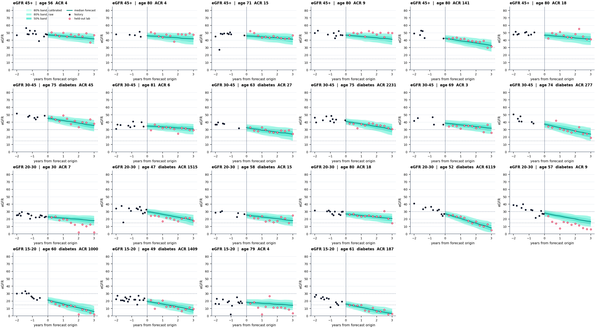

24 simulated test patients: history (black), held-out later labs (red rings), median forecast, 50% and 80% bands, and the calibrated band (light). Individual tiles: `figures/trajectories/sim_tile_01..24.png`.

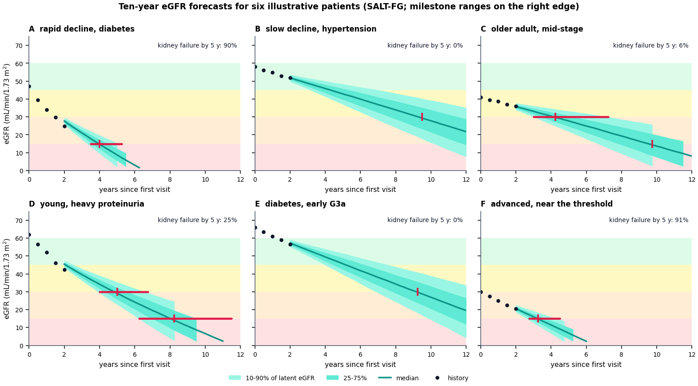

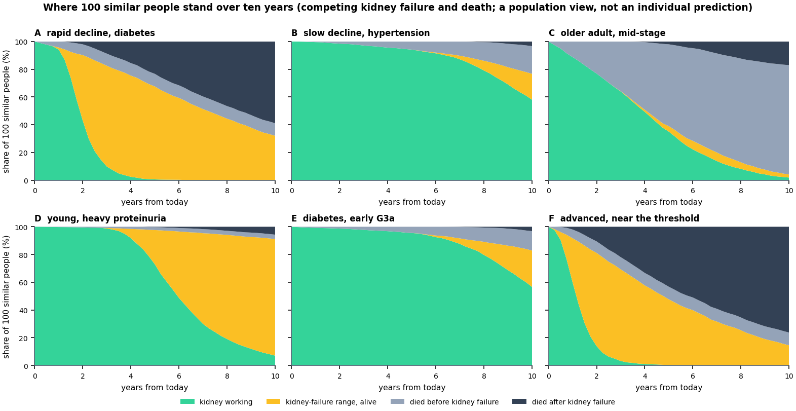

### Real patients and real kidney images

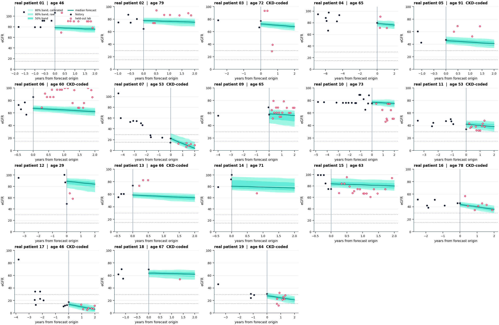

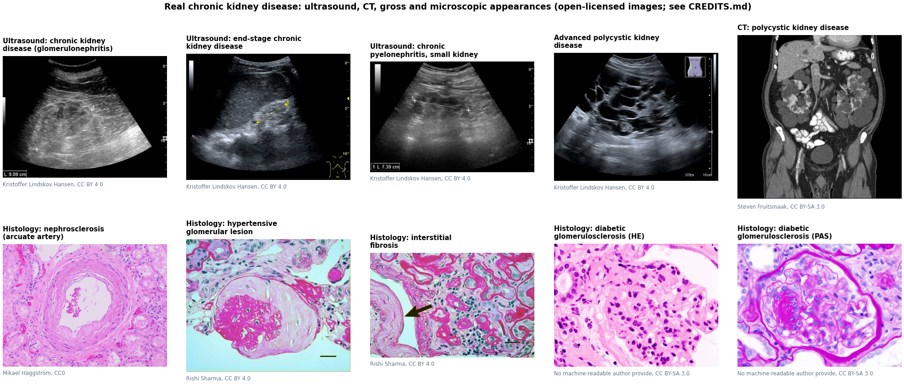

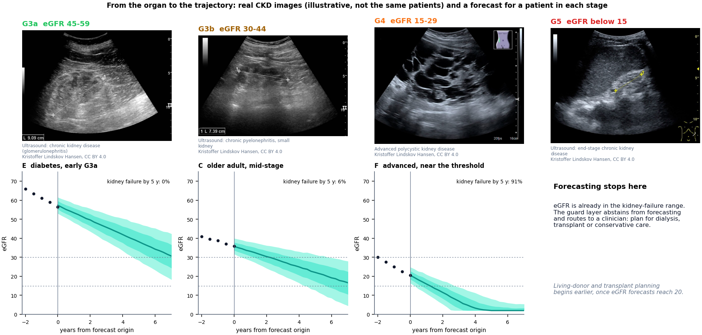

Image credits: `figures/kidney/CREDITS.md`. The images show kidney disease types; they are not images of the patients forecast.

### Calibration, comparison, what-if and diagnostics

| | |
|---|---|
| 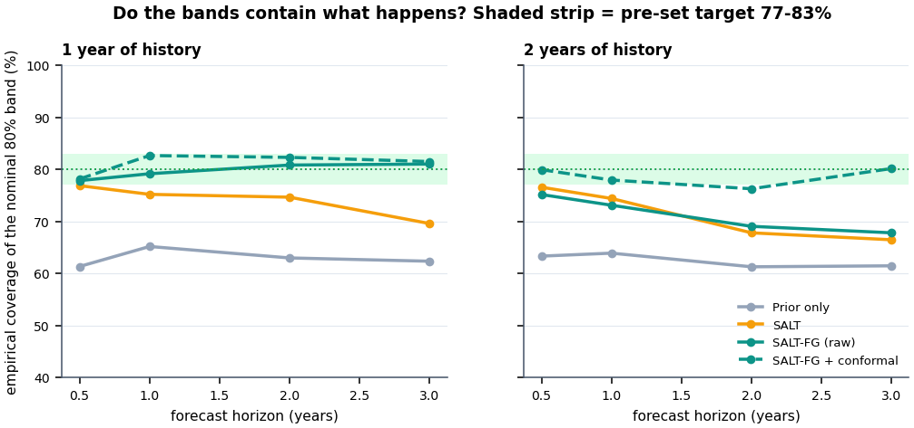 | 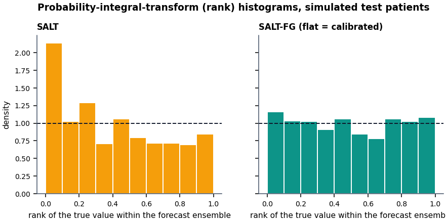 |
| 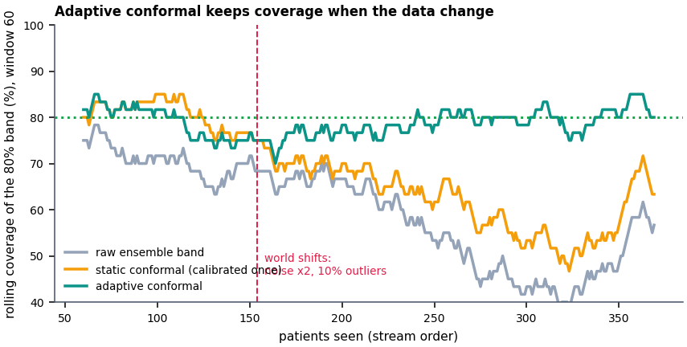 | 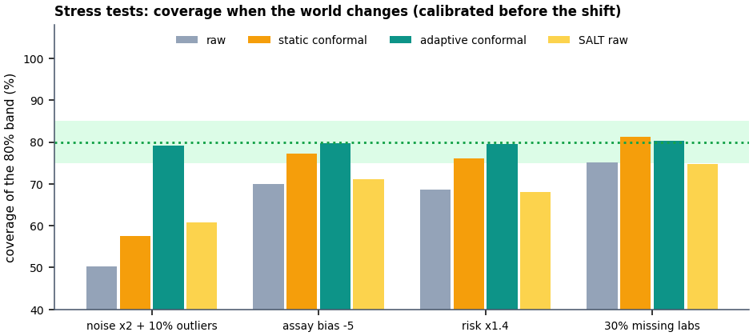 |
| 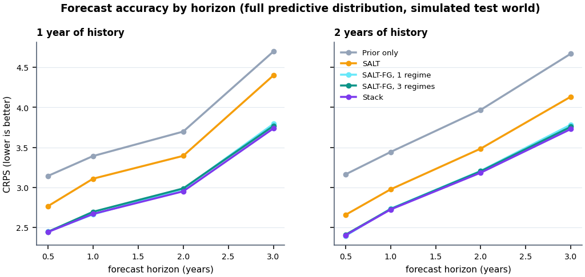 | 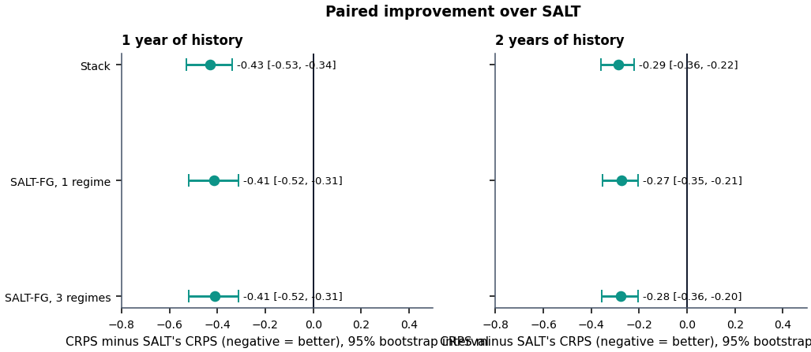 |
| 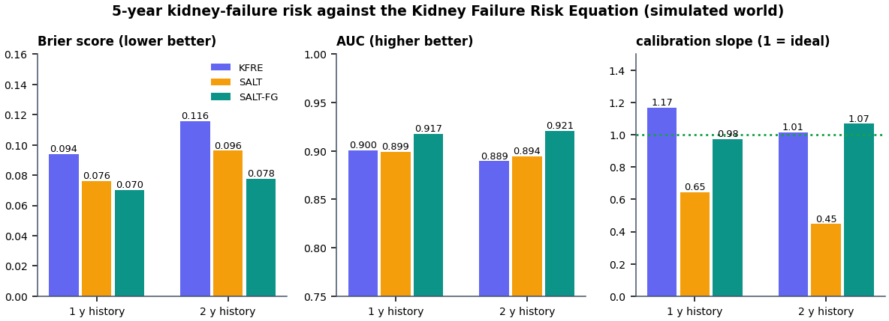 | 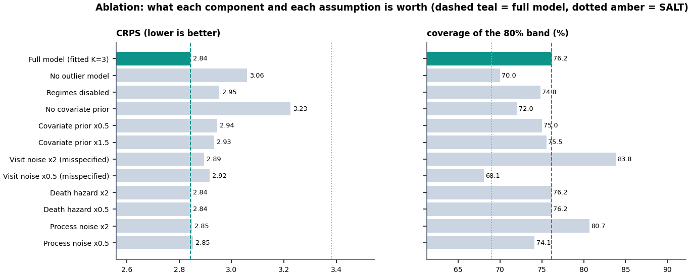 |
| 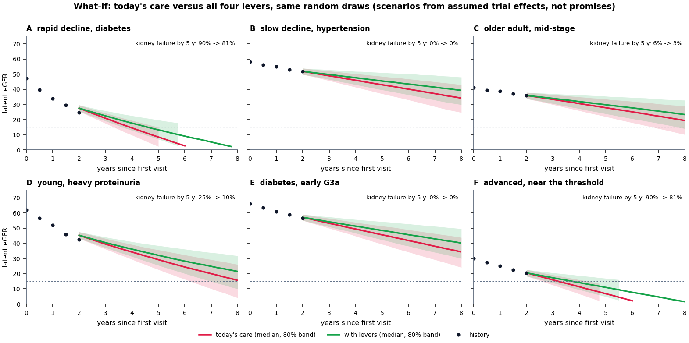 | 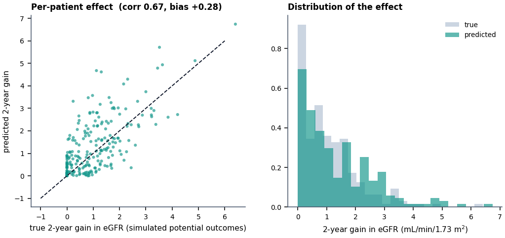 |
| 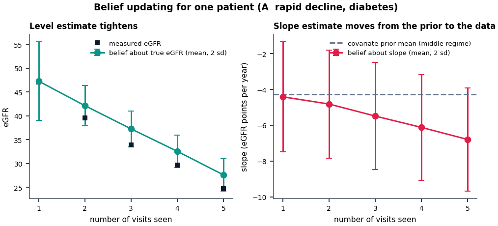 | 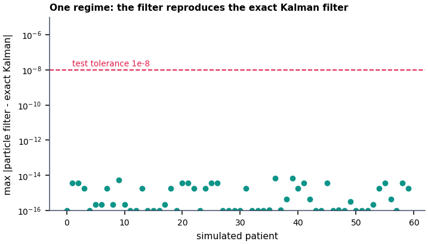 |

### Tables

All tables are in `tables/` as CSV and in `tables/tables.md`; image versions are in `figures/tables/`.

## Files

| Path | Content |
|---|---|
| `benchmark_round2.json`, `benchmark_round3.json` | full benchmark outputs (round 3 is the frozen-design replication) |
| `ablation.json`, `guard_eval.json`, `realdata.json` | ablation, guard evaluation, real-data check |
| `figures/` | 116 PNG images |
| `tables/` | 13 tables (CSV and Markdown) |

## Limits (please read)

1. **Simulated evidence.** The benchmark world is built by us. It is deliberately different from the model (heavy-tailed noise, spikes, informative visits, accelerating decline, frailty, different regime dynamics), but it is still a simulator. Nothing here is a clinical validation.
2. **Real data are tiny.** The MIMIC-IV demo gives 18 usable patients (a hospital population, creatinine only; blood pressure and usually albuminuria are set to defaults). The model, fitted only on simulated data, matches SALT there and beats the prior alone, but its raw bands are too narrow for real noise; conformal calibration restores coverage. This is indicative, not a validation.
3. **What-if effects are assumed** from trial effect sizes and are scenarios, not promises. The 2-year effect-error criterion failed in the simulated world (correlation about 0.6 with the truth).
4. **Hyper-parameters were fitted and tuned on simulated training patients.** Two fixes (immediate action effect, recalibrated risk) were made after round 1 failed, so round 2 and round 3 are a revised design, not a first-time pass. Round 3 used fresh seeds with the design frozen.
5. Clinical use needs a real longitudinal kidney cohort (for example a credentialed dataset or a partner hospital).
